## Freight Load Rate ML

A machine learning system designed to predict spot market shipping prices and contract rates for freight transportation.
By analyzing historical logistics data, market capacity, seasonal trends, this model provides data-driven rate forecasting to help shippers and logistics providers optimize supply chain costs and bidding strategies.

- [For Quick start (validation_predictions.csv)](#quick-start-validation)
- [For Quick start (score.py)](#quick-start-score)

---

## Objective & strategic value

* Rate Forecasting: Predicts real-time shipping costs based on lane, origin, and destination.
* Dynamic Pricing Factors: Accounts for seasonality, carrier capacity, and market volatility.
* Cost Optimization: Enables automated, data-driven decisions for procurement and spot-market bidding.

---

## Project architecture & directory structure

```text
freight-load-ml/
│
├── app/
│   └── app.py                  # Orchestrator that handles model training, prediction, and batch prediction
│
├── data/
│   └── raw/                    # all required .csv files are there
│
├── src/
│   └── v1/
│       ├── config.py           # Tuning distributions & configuration attributes
│       ├── evaluate.py         # Model evaluation and metrics logic
│       ├── main.py             # Main pipeline orchestrator
│       ├── train.py            # Main training pipeline
│       ├── prediction.py       # Main prediction pipeline (single and batch)
│       └── preprocessing.py    # Imbalance handling, imputing, feature engineering & scaling
│
├── plots/                      # Visualizations (EDA and model evaluation)
│   ├── features/               # Class distribution, plots, and correlation matrices
│   └── evaluate/               # Model comparison, and performance metrics
│
├── validation_predictions.csv  # Required predictions
├── README.md                   # Documentation about this project
├── pyproject.toml              # Project configuration profile (for validation_predictions.csv)
└── requirements_score.txt      # System dependencies manifest (for score.py)

```

---

## Feature engineering & exploratory data analysis

## Dataset and Features 

The project uses shipment-related information to predict freight rates (train-test.csv with 48,000 entries and 14 original features). The prediction input includes fields such as:
* Load ID
* Pickup
* Delivery
* Distance
* Equipment
* Weight
* Date
* Market index
* Quote signal 
* Pickup and delivery coordinates 
* Posted rate


---


## Data Preprocessing and Feature Engineering 

The preprocessing pipeline prepares raw shipment records for model training and prediction. 

### Taking care of some mistypes 

While performing EDA, I came across negative weights, which made no sense. How can weight be negative. Thus (.abs) was used to make sure the weight is positive. 

Assumption: the negative weight was mistyped. 

 

### Missing-value imputation 

The pipeline uses SimpleImputer with the following strategies: 

Numerical features: Median imputation. 

Categorical features: Most-frequent-value imputation. 

The custom freight feature engineer also handles missing shipment weights using equipment-specific medians when available, followed by a global training median. Missing market-index values are filled using a median learned during training. 

Of course, I could have used more complex way of handling the missing values like (taking the bimodal nature of the dataset into account. Though the december dataset doesn't fall in the large rate - its distance is low) But for sake of simplicity and time, I decided to use SimpleImputer.


### Feature engineering 

Additional features are generated to capture route geometry, transportation efficiency, and shipment characteristics:
* Haversine distance 
* Route circuity 
* Log distance 
* Pickup-delivery bearing 
* Midpoint latitude and longitude 
* Weight per mile 
* Market tension index
* Total payload weight
* Excess distance 
* Haul type


Note: After all the dropping and engineering new features, I arrived at 21 features, including original and engineered. 


### Categorical encoding and scaling 

Categorical variables, including equipment and haul type, are processed using one-hot encoding. 

For models that require feature scaling, the workflow uses RobustScaler. The fitted preprocessing pipeline and scaler are saved and reused during inference, helping maintain consistency between training and prediction. 

 

### Target information and transformation 

The training workflow applies log1p to the freight-rate target. This transformation can reduce the influence of highly skewed target values during model training. Predictions are converted back to the original rate scale using the inverse transformation before evaluation or presentation. 

I choose to split the dataset into 80/20 train-test splits, respectively. As stated earlier in the report, I decided to use y_binned – it was due to the reasons explained below (y having bimodal nature). 

In the preprocessing python script (preprocessing.py), there is the function called load_data. It handles the loading of data and uses binning for train_test_split (using stratify=y_binned). 

"Y" being bimodal, we have to make sure that its bimodal nature falls in both training and test set, otherwise it will leak data or perform extremely badly as the data in training would be different than that of test. 

So, to make sure that the target variables' bimodal nature falls in both training and test set, I binned them into 6 bins (doesn't have to be 6 can be 4 or 5 or 7 but making sure that the dataset bin is small enough as well as big enough for taking the bimodal nature into account – I decided to use 6 as it seemed like nice balance). 

Each bin would have certain number of entries and 80/20 split will be done using those bins, one bin at a time. So, yeah, this is why binning is used. 

As stated earlier, the target variable was transformed using np.log1p. Before such transformation, it had the following curve: 
 
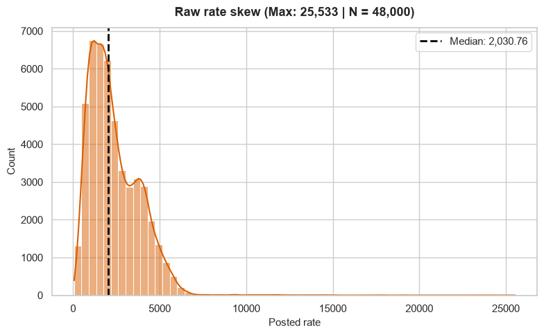
(fig: raw rate skew in the dataset) 

After such transformation: 

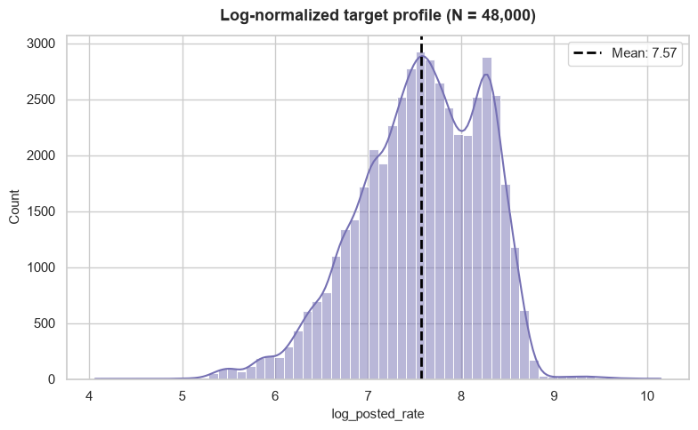

(fig: log-normalized rate skew in the dataset) 

So, yeah, the target variable seems to be bimodal (two peaks even after transformation). 

I dug deeper into why it was so, I came across this: 

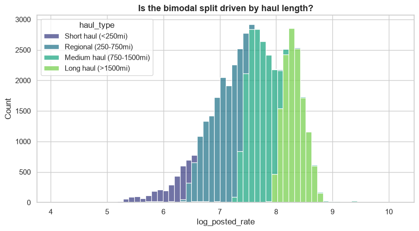

(fig: comparing the haul_type (custom feature) with the log_posted_rate) 

Now, that explains the bimodal nature of the target variable. So, the bimodal nature of the target variable seems to be explained by distance travel, which makes sense – longer the distance higher will be the cost. Long haul i.e. long distance  transport seem to be the reason behind such nature of the target variable. 

I also tried different variables to see if they can further explain the bimodal nature, such as: 

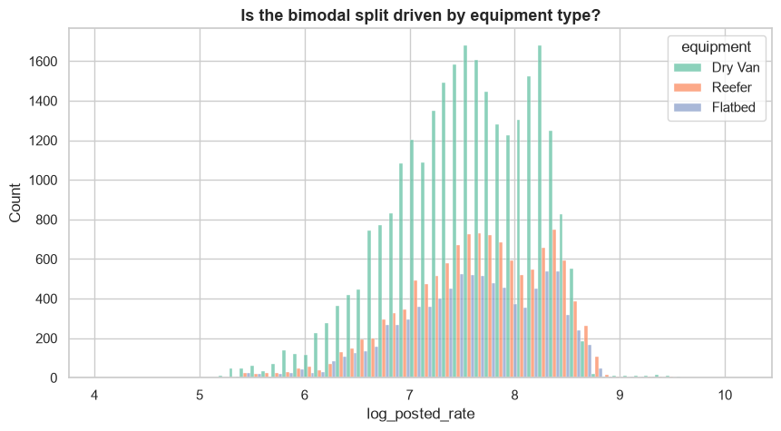

(fig: comparing equipment type with rate) 


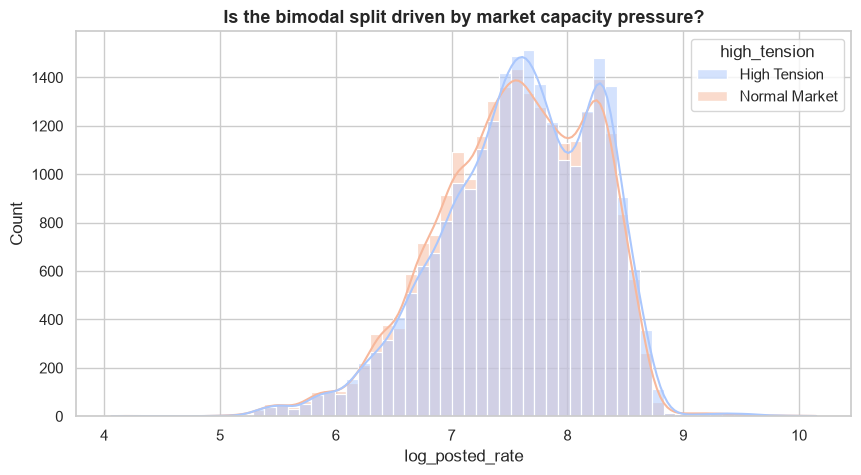

(fig: comparing market capacity with rate) 

Looking at those figures it becomes clear that neither of them could explain the bimodal nature. Equipment seems to be bimodal no matter the equipment type. And market tension also seems to inhibit the same bimodal nature. 

Only haul_type i.e. distance, could explain such bimodal nature.


### Other feature comparison 

**Posted rate and market tension index**

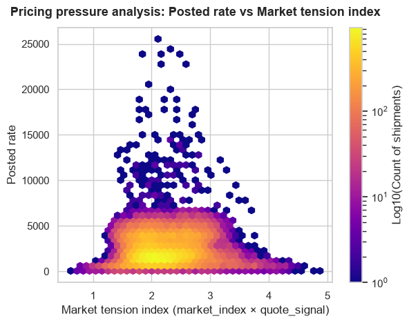

(fig: comparison between rate and market tension)

Look at how tightly clustered the bulk of the shipments remain around index scores of 2.0 to 3.0. the extreme vertical outliers scaling past 15,000 appear almost exclusively inside this specific pressure zone rather than spreading randomly, meaning high prices are concentrated during high quote-to-market traffic spikes. 

 

### Feature importance and correlation 

**Let's discuss briefly about feature importance:**

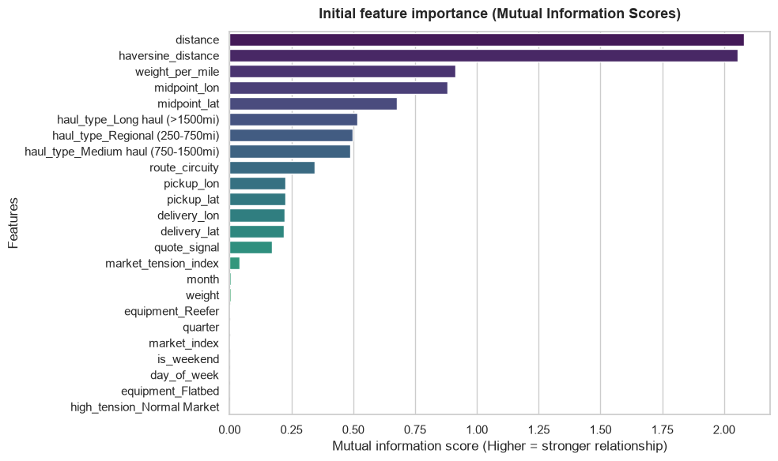

(fig: feature importance – initial (not SHAP))

From the above plot, it is clear distance and haversine_distance are the most important features (each having over mis of 2).  

Whereas, if we look at the weight_per_mile (mis of roughly close to 1) and weight (mis of near 0), it seems like weight matters when considered with how far it has to be transported.

But features such month, weight, equipment_Reefer, etc. seem to be dead weight. thus, they can be dropped.


**Now, let's discuss briefly about feature correlation:**

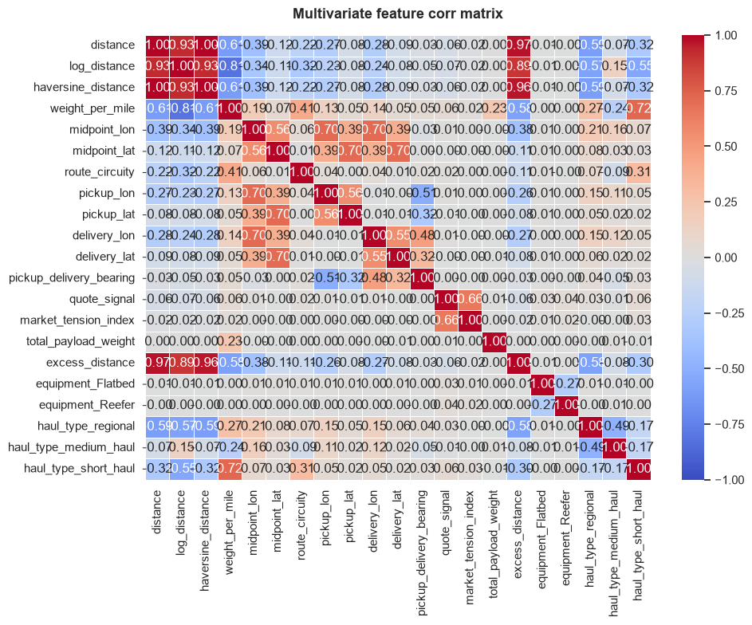

(fig: feature correlation)

Looking at the above matrix, some features have low correlation while others have perfect correlation. 

Haversine_distance, log_distance, excess_distance and distance seem to be corr perfectly or pretty close to perfect corr. While pretty much all other features have pretty low correlation. 

If such correlation exists, why are those features kept. Well, because I choose to use tree-based models rather than models like Logistic Regression. More on that later. 


### About validation_predictions.csv and december-chart-inputs.csv 

Validation_prediction.csv was pretty easy to predict, but december-chart-inputs.csv (dec from now on) was slightly more difficult. 

The given file (of dec) didn't have required features such as: 'load_id', 'pickup_lat', 'pickup_lon', 'delivery_lat', 'delivery_lon', 'market_index' and 'quote_signal'. 

After trying many ways, I decided to add those features as NA and let the preprocessor function handle the imputing. Of course, it means that those values are now median of the train dataset. And of course, the output feature is the same as the original file itself; only the predicted value is added.

FOR FUTURE REFERENCE: if the datasets in productions is like this file, this way of getting around the hurdle could be used. But it comes at the costs of those empty values being same distribution as training dataset (it can be a problem if the dataset in the future suffers from DDS). So, assuming the future dataset follow the same distribution, this can be used.

Also, the dec file also seems to be one data instance copied 30 times, thus making it 31 entries. So, in the file, you will see the same predicted value over and over again.

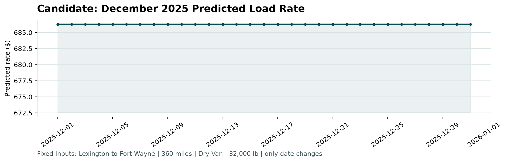

---

## Models evaluation

Four model configurations were compared.

| Model            | Validation R² | Validation RMSE | Test R²  | Test RMSE | Test MAE |
|------------------|--------------:|----------------:|---------:|----------:|---------:|
| LightGBM         | 0.945883      | 615.6351        | 0.949794 | 570.4531  | 103.7327 |
| XGBoost          | 0.947277      | 610.9740        | 0.949913 | 569.4803  | 103.0655 |
| Random Forest    | 0.951245      | 595.6652        | 0.949678 | 569.7101  | 101.6093 |
| Advanced Ensemble | 0.948957      | 605.1277        | 0.950190 | 568.8200  | 98.36488 |


### LightGBM 

LightGBM is a gradient-boosting framework that builds decision trees sequentially to minimize prediction error. It can model nonlinear relationships and interactions among shipment features. 


(fig: Regression fit of LightGBM) 

 

### XGBoost 

XGBoost is a gradient-boosting algorithm that combines multiple decision trees. Its regularization and optimization mechanisms make it suitable for structured tabular data and complex relationships between shipment characteristics and freight rates. 

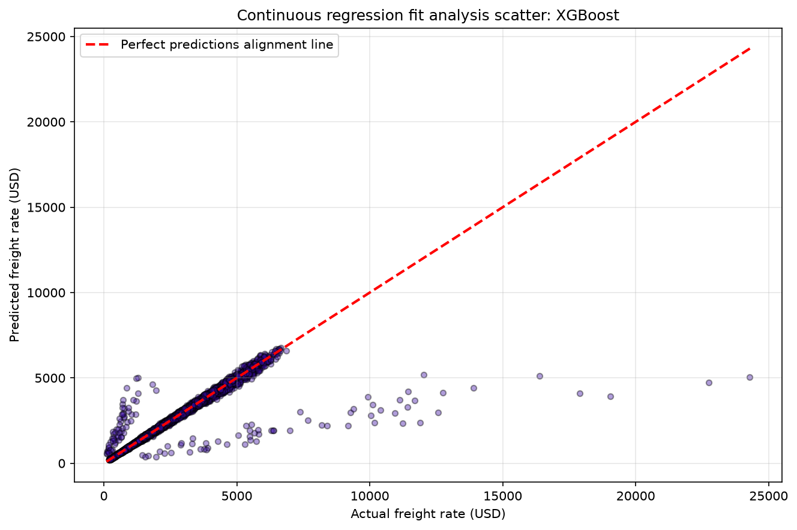

(fig: Regression fit of XGBoost) 

 

### Random Forest 

Random Forest combines predictions from multiple decision trees trained on different samples and feature subsets. It can capture nonlinear patterns and interactions while reducing the variance associated with an individual decision tree. 

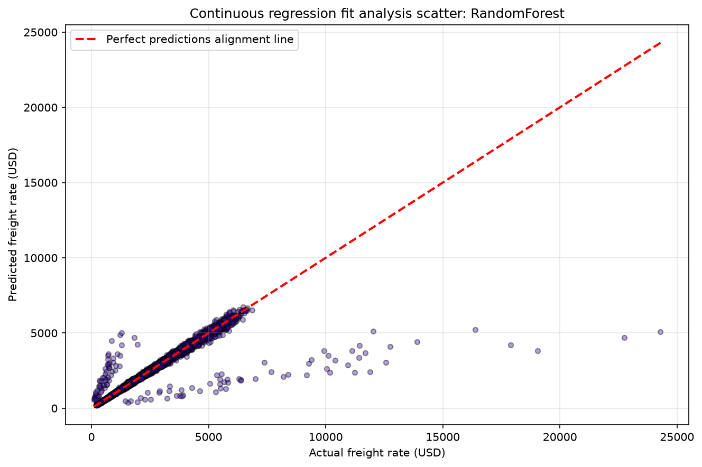

(fig: Regression fit of Random Forest) 

 

### Advanced Ensemble 

The Advanced Ensemble is the combined model configuration evaluated in this project. Its reported performance suggests that combining predictive approaches may provide a more balanced estimate than relying on one individual model. 

The precise ensemble composition and combination strategy should be documented separately if the report is intended to describe the implementation in full technical detail. 

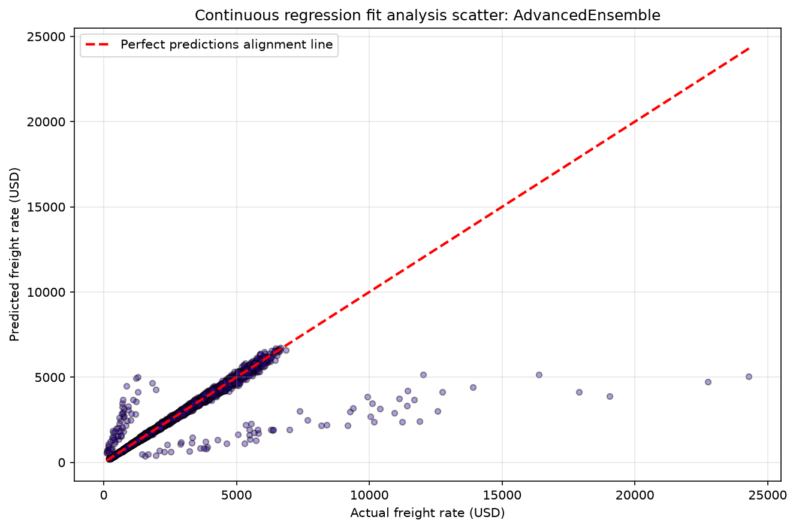

(fig: Regression fit of Advanced Ensemble) 


---


### Interpretation 

The following table presents the supplied validation and final evaluation results. 


#### Evaluation performance

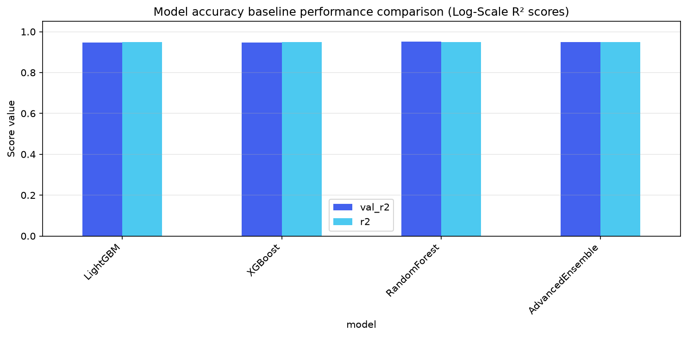

(fig: performance evaluation of different models)

The Advanced Ensemble achieved the highest reported R² of 0.950190 and the lowest RMSE of 568.8200. 

Its MAE of 98.36488 was also the lowest among the evaluated models. This indicates that the ensemble produced the smallest average absolute prediction error in the reported evaluation. 

XGBoost achieved an R² of 0.949913 and RMSE of 569.4803, making it a close competitor in terms of explained variance and squared prediction error. 

Random Forest achieved an MAE of 101.6093, outperforming both standalone boosting models on this metric, but its final R² and RMSE were marginally weaker than those of the Advanced Ensemble. 

LightGBM recorded an R² of 0.949794, RMSE of 570.4531, and MAE of 103.7327. It remained competitive, although its final MAE was the highest among the four configurations. 

Since I don't know if this model is for online or batch prediction. well, I guess that is what validation.csv is for basically batch prediction. 

For online prediction, LightGBM would make more sense as it is lightweight and consumes less memory and of course, performs similar to other models including ensembles. 

So, I will assume this is for batch prediction and thus will use ensemble (adv) in production. 

---

## Quick start validation

### For validation_predictions.csv

### 1. Environment setup - Using pyproject.toml

```bash
# Clone the repository
git clone https://github.com/officialroshanshahi/freight-load-ml.git
cd freight-load-ml

# Create and activate a Python virtual environment
python -m venv venv
source venv/bin/activate  # On Windows: venv\Scripts\activate

# Install the project and its dependencies using pyproject.toml
pip install .

```

### 2. Launch the streamlit UI

Launch the web dashboard for single or batch transaction scoring:

```bash
# Has to be in project root
python -m streamlit run app/app.py

```

### 3. The UI will launch on its own - on the left of the UI you will see drop-down menu, choose:
* **Model training** - for training the model and getting evaluation metrics
* **Single inference** - prediction for single instance of the dataset
* **Batch prediction** - for validation_predictions.csv (it will spit out the file in the root project folder or you can simply download it from the UI)
* **December prediction** - for december-chart-inputs.csv

---


## Quick start score

### For score.py

```bash
# Clone the repository
git clone https://github.com/officialroshanshahi/freight-load-ml.git
cd freight-load-ml

# Create and activate a Python virtual environment
py -3.14 -m venv .venv-score

# Install the project and its dependencies using requirements_score.txt
.\.venv-score\Scripts\python.exe -m pip install -r requirements_score.txt

# Run the score.py using
.\.venv-score\Scripts\python.exe -m src.v1.score --predictions validation_predictions.csv --december-predictions data/raw/december-chart-inputs.csv

```

---


## Model lifecycle & MLOps practices

1. **Preprocessing (`src/v1/preprocessing.py`)**: Handles class imbalance resampling, missing value imputation, and feature scaling.
2. **Training & Evaluation (`src/v1/train.py`, `src/v1/evaluate.py`)**: Executes cross-validation, evaluates Precision-Recall AUC and ROC metrics, and serializes production model artifacts.
3. **Prediction (`src/v1/prediction.py`)**: Predicts single, batch, and of course, december batch.
